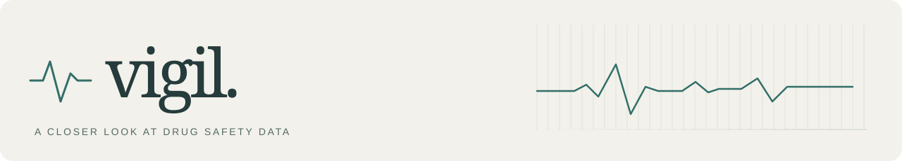
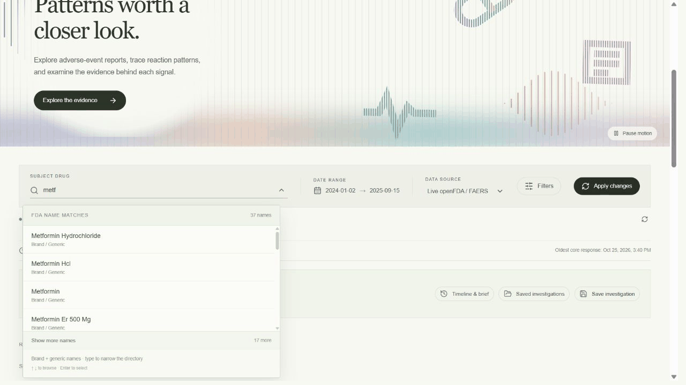
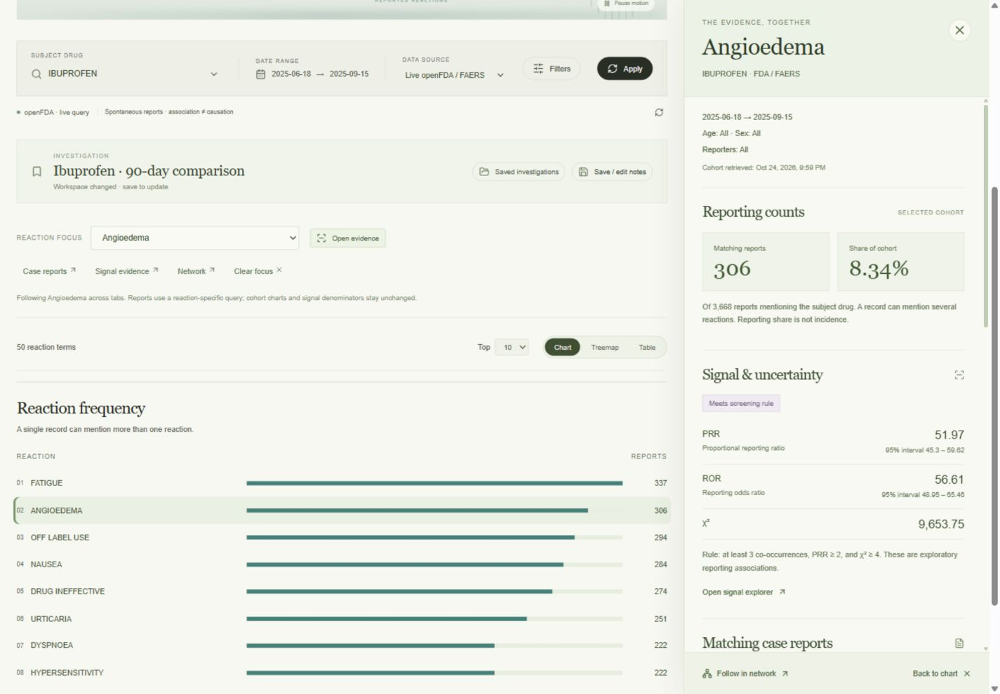
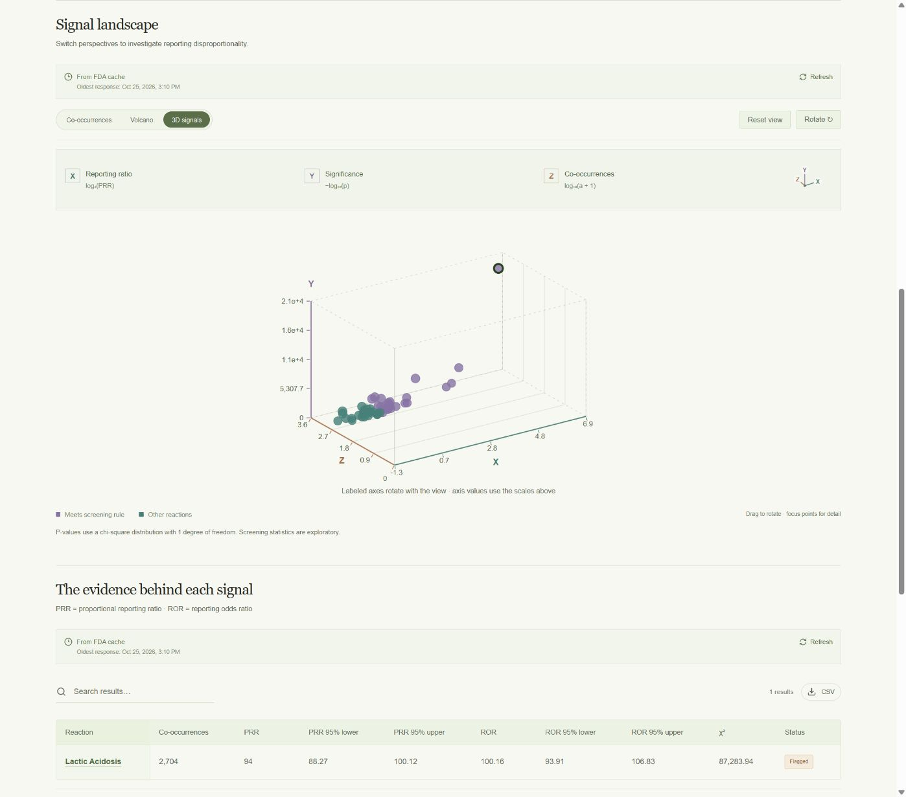

<p align="center">
  
</p>

<p align="center">
  Explore FDA reports, follow reaction patterns, and keep the evidence together.<br />
  <em>Fewer spreadsheet tabs. More connecting the dots.</em>
</p>

<p align="center">
  <strong><a href="https://vigil-drug-safety.onrender.com/">Open Vigil ↗</a></strong>
  &nbsp; · &nbsp;
  <a href="docs/DEMO.md">Take the quick tour</a>
  &nbsp; · &nbsp;
  <a href="#run-it-yourself">Run locally</a>
</p>

<p align="center"><sub>Free hosting may need a minute to wake up. Relatable.</sub></p>



### Pick a drug. Follow the evidence.

Vigil brings live **openFDA / FAERS** data into one research workspace. FAERS is the [FDA Adverse Event Reporting System](https://open.fda.gov/apis/drug/event/): reports of adverse events and medication errors submitted to the FDA.

The idea is to make a question like *“Why does this reaction stand out?”* easier to follow. Search a drug, choose a cohort, compare reporting patterns, and trace a reaction from its chart to the supporting reports. Save your notes alongside the filters so tomorrow-you can pick up the thread.

The project started in Streamlit and grew into a React app covering data retrieval, statistical screening, model evaluation, and deployment. The original app and pipeline are still included.

| What you want to do | Where Vigil helps |
| --- | --- |
| **Spot a pattern** | Weekly trends, drug comparisons, reaction maps, and interactive 3D signal plots. |
| **Check the evidence** | PRR/ROR estimates with confidence intervals, case reports, severity, and demographics. |
| **Keep your place** | Saved investigations, notes, revision history, CSV exports, and a downloadable research brief. |
| **Try the models** | Logistic Regression and XGBoost, held-out evaluation, threshold controls, and a feature proxy audit. |
| **Read between the lines** | Narrative keywords, phrase mentions, negation, and text/CSV analysis. |

**Try this first:** search **Metformin** → apply your dates → select a reaction → open its evidence drawer.

<table>
  <tr>
    <td width="50%"><a href="docs/preview-evidence-drawer.png"></a></td>
    <td width="50%"><a href="docs/preview-3d-signal-axes.png"></a></td>
  </tr>
  <tr>
    <td align="center"><sub>Follow a reaction into its evidence.</sub></td>
    <td align="center"><sub>Explore signals from another angle. Literally.</sub></td>
  </tr>
</table>

### How the analysis works

- **Signals come with context.** PRR and ROR compare reaction reporting with and without the selected drug. Report counts and confidence intervals stay visible so you can judge the strength and uncertainty of a pattern.
- **Models get a proper check.** Logistic Regression and XGBoost classify reported seriousness using the same held-out records. Full and reduced feature sets help examine how administrative details might influence predictions.
- **Text analysis stays inspectable.** TF-IDF keywords, phrase rules, and limited negation handling make it possible to see how narrative results were produced.

The engineering side includes cached FDA requests, separate visitor libraries, revision tracking, and Docker deployment. **Render + Neon** power the public app; the project also has a separate **AWS EC2 + Caddy HTTPS** deployment.

### Run it yourself

With **Node.js 22+** and **Python 3.12 or 3.13** installed, clone the release branch and launch from PowerShell:

```powershell
git clone --branch codex/v1-release https://github.com/Kevinm360/Vigil-Drug-Safety.git
cd Vigil-Drug-Safety
.\start.ps1
```

Open **http://127.0.0.1:8766**. The launcher handles the build and local dependencies.

<details>
<summary><strong>API key &amp; hosting</strong></summary>

Set your openFDA key on the server as `OPENFDA_API_KEY`, or in the ignored local `.streamlit/secrets.toml` file. Keep keys and database URLs out of Git.

The Render app supports public visitor workspaces: each browser gets its own saved investigation library. Clearing site cookies or changing browsers starts a new library. For setup and private owner access, see the [deployment guide](docs/DEPLOYMENT.md).

The project has also been deployed on **AWS EC2 with Docker and Caddy HTTPS**. The public link above uses Render; the [AWS guide](docs/PUBLIC-DEMO.md) covers the separate EC2 setup.

</details>

<details>
<summary><strong>Under the hood</strong></summary>

| Layer | Tools |
| --- | --- |
| Interface | React, Vite, Three.js |
| API | Python, Flask, Gunicorn |
| Analysis | scikit-learn, XGBoost, inspectable NLP rules |
| Storage | SQLite locally; PostgreSQL / Neon when hosted |
| Deployment | Docker, Render; AWS EC2 deployment documented |

The original Streamlit app and Prefect/MLflow pipeline are preserved. See the [technical guide](docs/PROJECT-GUIDE.md), [restoration notes](docs/RESTORATION.md), and [verification notes](docs/RELEASE-v1.md).

</details>

---

**A signal is a reason to investigate, not a verdict.** FAERS reports do not establish causation or incidence. Model predictions describe report labels, not a person's medical risk. Synthetic archive data is labeled separately. This is a research project, not medical advice.
