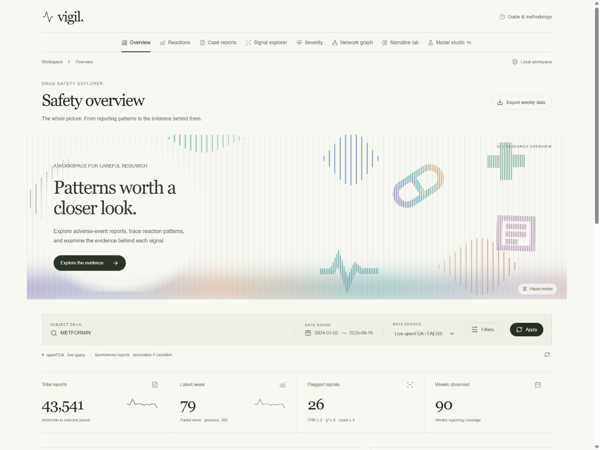

# Vigil · Side Effects Signal Monitor

A React interface for the original FAERS signal dashboard, with a local Python API and the complete Streamlit app preserved.

The interface uses warm paper tones, editorial serif headings, thin rules, and an animated vertical line field inspired by AfterQuery. The animation uses original medical and data symbols, with a pause control and a static reduced-motion version. Every research tab also has an animated striped icon and a bottom color wash matched to its accent. Decorative motion pauses offscreen and when the tab is hidden. Charts use restrained, flat colors so the evidence remains readable.



The reaction network is an aligned relationship map with a count matrix, reaction search, source highlighting, sorting, density controls, and separate per-drug counts on selection. It starts with **Live openFDA / FAERS**. Set a drug and date range, then press **Apply**. The supplied synthetic archive remains available as an explicit alternative for offline interface exploration.

## Run

From this project folder in PowerShell:

```powershell
.\start.ps1
```

Open **http://127.0.0.1:8766**. The launcher builds the React app and serves it with the API on one local port. It installs dependencies if the project environment is missing. Node.js 22+ and Python 3.12 or 3.13 are recommended.

To keep the app running after you close the terminal, use `.\start.ps1 -Background`. Stop that background app with `.\stop.ps1`. Use `-Port 8765` if you want to reuse a browser tab already pointing at port 8765. Background process details and logs stay in the ignored `.vigil-runtime/` directory.

The subject and comparison fields provide a searchable dropdown of FDA brand and generic names, with debounced lookup, keyboard selection, and incremental browsing. Suggestions come from the FDA NDC directory independently of the active cohort; directory listings do not imply FDA approval. Browse results are bounded, and typing searches the directory more specifically. Manual drug-name entry remains available if suggestions cannot load. Archive mode lists only its available drugs.

Applied cohort filters survive a reload within the same browser session. Earlier saved cohorts migrate once to FDA mode; subsequent explicit source choices are remembered. Closing the filter dialog discards its uncommitted edits. The main export button exports evidence from the current view; tables also provide their own filtered CSV exports. Browser storage contains only cohort settings, not narratives, reports, model outputs, or credentials.

Manual setup:

```powershell
python -m venv .venv
.\.venv\Scripts\python.exe -m pip install -r requirements.txt
npm ci
npm run build
.\.venv\Scripts\python.exe backend/server.py --port 8766
```

The archive, signal statistics, and narrative API work with Python's standard library. Model training and the legacy dashboard require the Python packages above. Development: run the API on port 8765 and `npm run dev` in a second terminal; Vite proxies `/api` to 8765.

## Explore

| View | Available tools |
| --- | --- |
| Overview | Weekly trend, drug comparison, cohort metrics, computed evidence brief, reaction bars, network preview |
| Reactions | Ranked bars, area-proportional treemap, comparison, sortable/searchable table |
| Case reports | Real live FAERS samples or clearly labeled synthetic archive records, CSV export |
| Signal explorer | PRR/ROR with 95% intervals, count/ratio scatter, volcano plot, rotatable 3D projection, flags, weekly bursts |
| Severity | Live reported outcomes, demographics, and serious-reaction comparisons |
| Network graph | Aligned drug–reaction map, count matrix, source highlighting, reaction search/sorting, selection, density controls |
| Narrative lab | Text/CSV analysis, device narrative retrieval, keywords, clinical and negated phrase mentions, lexical sentiment, contrastive terms, exports |
| Model studio | Adjustable training sample, Logistic Regression and XGBoost, paired full/reduced features, chronological held-out evaluation where feasible, ROC/PR curves, probability distributions, adjustable threshold/confusion matrix, coefficients, importances, proxy audit |

The complete original app remains available for its original Plotly 3D scatter, Three.js force graph, PyVis graph physics, and advanced Streamlit controls:

```powershell
.\.venv\Scripts\python.exe -m streamlit run app/streamlit_app.py
```

Untouched original sources are in `original_sources/`. Restoration details and the functionality matrix are in [docs/RESTORATION.md](docs/RESTORATION.md). The original screenshot, animation, and README are in `docs/reference/`.

## Credentials

The server reads `OPENFDA_API_KEY` from the environment or `.streamlit/secrets.toml`. The supplied key was restored only to that gitignored local file. Credentials never enter the React bundle. For a fresh installation, set an environment variable or create:

```toml
OPENFDA_API_KEY = "your-openFDA-key"
```

Public requests are subject to openFDA authentication and rate limits. A failed live query displays its error and never silently substitutes synthetic data. FDA counts and aggregate responses are cached for five minutes; FDA drug-name lookups are cached for one day. A bounded SQLite cache in `.vigil-runtime/fda-cache.sqlite3` preserves these responses across restarts. Expired responses are never used as an offline fallback. Raw case reports, uploaded narratives, model outputs, and API keys are excluded from this database. If SQLite is unavailable, the app continues with memory caching and normal FDA requests. Uploaded narrative text is processed locally without persistence or transmission to a language-model service. The interface uses local system fonts and renders its decorative animation without external assets.

## AI and data reliability

- The supplied 2,000 reviews are synthetic text generated by the original ingestion pipeline. Their metrics are demonstrations, not clinical evidence. Cached legacy probabilities appear misaligned with labels and are retained only as original artifacts; the React API recomputes statistics from the CSV.
- The review classifier now deduplicates normalized text before a fixed held-out split. TF-IDF and the classifier fit only training data. Synthetic keyword labels can still produce perfect held-out scores; this does not validate clinical performance.
- Live seriousness models exclude direct outcome fields and compare full/reduced versions on identical held-out records. Threshold controls use actual held-out labels and probabilities. The sample is bounded and does not represent all FAERS reports.
- Narrative analysis uses inspectable TF-IDF, phrase rules with a limited negation window, and a small sentiment lexicon. It is not a clinical language model or diagnostic system. The evidence brief is calculated from the displayed cohort.
- Daily openFDA counts are aggregated to actual Monday-start weeks. Missing weeks are filled; partial final weeks are identified. Signal denominators use the same period/cohort, and rare zero cells receive continuity correction.

FAERS reports cannot establish causation or incidence and should not determine an individual's treatment or medical risk. See the [FDA's dataset overview and limitations](https://open.fda.gov/apis/drug/event/).

## Verification

```powershell
npm run build
npm test
.\.venv\Scripts\python.exe -m unittest discover -s tests -v
```

The regression suite checks query/cohort consistency, time aggregation, signal calculations and intervals, NLP negation, provenance, API validation, score alignment, held-out splitting, and alert filtering. Live smoke checks require network access and the configured openFDA key.

Verified during implementation: production build; 83 Python regression tests and 15 frontend state/export/network tests; live FDA cohort totals matching weekly aggregation; all four models on real held-out reports; negation-aware narrative output; CSV export; mobile layout/navigation. A broad 1,000-report training query also passed using adaptive page sizes to recover oversized FDA responses. Any individual oversized record that must be omitted is disclosed in the returned sample metadata.

Comparison requests expose availability for volume, reactions, and totals separately. An unavailable value remains unknown instead of appearing as zero; a successful empty response remains a genuine zero. Comparison data can still load when the subject drug has no matching reports. Narrative tables and exports retain every analyzed record within the accepted upload limit.

Repeat a live check with `.\.venv\Scripts\python.exe tests/smoke_live.py --train 300 --device-narratives`.

The original Prefect/MLflow workflow is retained separately. Install `requirements-pipeline.txt` to run `run_pipeline.py`. Scheduling and notifications have not been activated by the redesign.


## SQLite cache

The Python standard-library `sqlite3` module manages the local cache; no database service or new dependency is needed. It is limited to 512 entries and 32 MB of response payloads, with a 1 MB entry limit. Cache keys distinguish endpoint, query/cohort, and response type using a digest without the API credential. Expiry and age indexes support lookup and eviction, and short transactions use separate connections with per-file synchronization. Cache failures do not block FDA requests.

Only public FDA aggregates, totals, and NDC name results are persisted. Count-only requests retain the total and discard their returned case record before caching. Live dashboards are assembled from the individual cached FDA responses so another dashboard cache does not extend their expiration. `/api/health` reports SQLite availability, fresh-entry counts, payload size, and cache hits for the current server process. The cache file and sidecar files are excluded from Git by `.vigil-runtime/`.


## Saved investigations and connected tabs

Use **Save investigation** to name the applied cohort and add research notes. The saved workspace includes the subject/comparison drugs, dates, demographic and reporter filters, current tab, selected reaction, and the data retrieval time. Unapplied filter edits are excluded. **Saved investigations** opens a searchable library; opening an entry restores the controls and reaction focus and reloads data. **Save / edit notes** updates it, while **Save as new** keeps a separate investigation. Deletion requires an inline confirmation. Revision checks prevent another browser window from silently overwriting or deleting a newer save.

Research notes and workspace settings live in `.vigil-workspace/investigations.sqlite3`, separate from `.vigil-runtime/` and its disposable FDA cache. Both folders are ignored by Git. To back up your investigations, stop Vigil with `stop.ps1` and copy the entire `.vigil-workspace` folder to your backup location; restore that folder while the app is stopped. Git checkpoints preserve the application code, not your private investigation library. Saved investigations survive app restarts but do not freeze FDA data or save case report contents, uploaded text, model outputs, or credentials. The library accepts up to 500 investigations and 10,000 characters of notes per investigation.

Click a reaction bar, treemap tile, signal point, reaction table link, or network row to set **Reaction focus**. The focus remains when switching tabs, and its shortcuts lead to **Case reports**, **Signal evidence**, and **Network**. The focused report endpoint queries the same subject, dates, and demographic/reporter cohort plus the exact quoted reaction term; it shows a bounded sample of the latest 20 matching FDA reports and their aggregate matching count. The synthetic archive uses exact extracted terms instead. Failed queries show an error instead of substituting unfiltered records. Signal evidence and its CSV export follow the selected reaction; the chart retains the full landscape and highlights it. Cohort charts and PRR/ROR denominators remain unchanged. Applying a new cohort clears the old focus; opening a saved investigation restores its saved focus.

Local API: `GET /api/investigations`, `GET /api/investigations?id=...`, `POST /api/investigations/save`, `POST /api/investigations/delete`, and `GET /api/reaction-reports?...&reaction=...`. These use the same local-host/origin and JSON validation as the existing API. No new dependency or database service is needed.


## What changed? Period comparisons

Open **What changed?** in the main navigation, or use **Compare periods** in Signal explorer. Both periods use the applied subject drug, source, age, sex, and reporter filters. The comparison drug is excluded from this view. Choose non-overlapping baseline/current dates, or a 30/90/180-day preset anchored to the current end date. **Compare & apply dates** updates the workspace's current period, so connected reports and signals use the same dates. Pending period edits are excluded from saved investigations.

The view shows raw report totals, per-reaction counts, count differences, reporting shares, and current-minus-baseline share changes in percentage points. An interval chart, searchable table, direction/minimum-count controls, pagination, CSV exports, and links to matching reports support investigation. The candidate list is the union of the 50 most reported reactions in each period. An absent term is zero only when the underlying aggregation is complete; otherwise the server requests its exact count. Failed counts remain unknown. Empty periods have no share denominator and never receive an inferred share-change or newly-reported classification. “Only current period” means zero in the selected baseline, not a newly discovered reaction. Sparse counts are identified when either period has fewer than five reports for the reaction.

Uncertainty uses unadjusted 95% [Newcombe–Wilson intervals for the difference of two proportions](https://pubmed.ncbi.nlm.nih.gov/9595617/), built from [Wilson score intervals](https://www.itl.nist.gov/div898/handbook/prc/section2/prc241.htm). Higher/lower share labels require the interval to exclude zero. These exploratory intervals do not correct for multiple comparisons, duplicate/dependent reports, reporting bias, or changes in case mix. They do not estimate incidence or individual medical risk. Raw counts from different-duration windows are explicitly marked as not directly comparable.

Saved investigations now retain the baseline period as well as the current cohort. The local SQLite schema migrates existing investigations automatically, preserving their identifiers, notes, and revisions. Previous saves with no baseline use the immediately preceding equal-duration period when opened. The cache continues to store only eligible FDA aggregates/totals. `GET /api/changes` accepts the normal cohort fields plus `baseline_start` and `baseline_end`; no report text or credentials are added to saved comparison settings.
